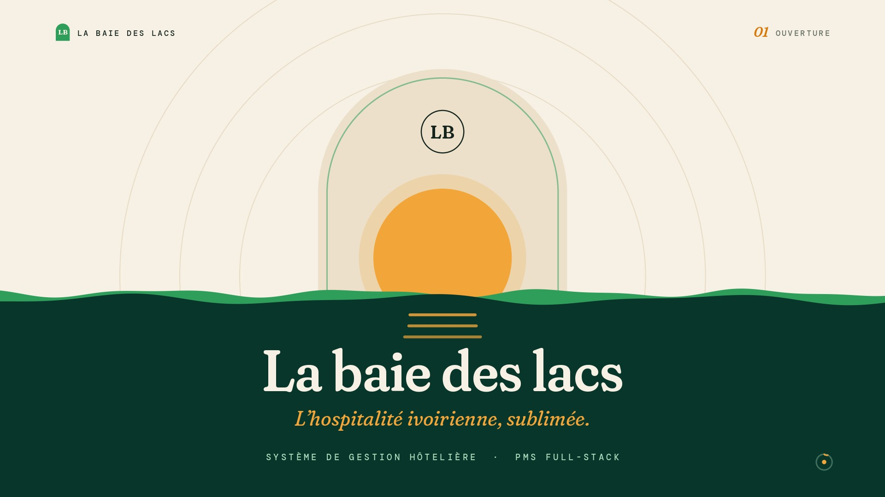

# Système de gestion hôtelière — La baie des lacs


Logiciel de gestion hôtelière (PMS) complet : **le cycle entier d'un séjour, de la réservation en ligne au départ du client**, avec les paiements mobiles ivoiriens, le ménage, les réclamations, les remboursements et le journal d'audit. Quatre espaces distincts — visiteur, client, personnel, direction — partagent la même base et se synchronisent **en temps réel, sans rechargement de page**.

[](https://gomugomuno01.github.io/hotel-management-system/)

*Présentation : une minute pour parcourir le produit, animée image par image en Python sur une musique originale synthétisée pour elle. Hébergée sur GitHub Pages, aucune installation.*



*Le parcours de réservation, du catalogue au paiement, tel qu'il apparaît dans la vidéo de présentation.*

---

## Sommaire

1. [Le projet en bref](#1-le-projet-en-bref)
2. [Les résultats en bref](#2-les-résultats-en-bref)
3. [Contexte et objectifs](#3-contexte-et-objectifs)
4. [Problématiques traitées](#4-problématiques-traitées)
5. [Architecture et rôles](#5-architecture-et-rôles)
6. [Outils et technologies](#6-outils-et-technologies)
7. [Parcours fonctionnels](#7-parcours-fonctionnels)
8. [Système de paiement](#8-système-de-paiement)
9. [Temps réel](#9-temps-réel)
10. [Sécurité et conformité](#10-sécurité-et-conformité)
11. [Tests et qualité](#11-tests-et-qualité)
12. [Principaux enseignements](#12-principaux-enseignements)
13. [Structure du projet](#13-structure-du-projet)
14. [Reproduire le projet](#14-reproduire-le-projet)
15. [Limites et pistes d'amélioration](#15-limites-et-pistes-daméliorations)
16. [Crédits](#16-crédits)

---

## 1. Le projet en bref

> **En une phrase :** j'ai construit le logiciel qui fait tourner un hôtel — réserver, encaisser, accueillir, nettoyer, répondre, rembourser, tracer — en traitant le conflit de réservation comme un problème de base de données plutôt que comme un problème d'interface.

### La situation

Un hôtel de taille moyenne gère ses chambres sur un cahier ou un classeur Excel. Deux réservations tombent sur la même chambre aux mêmes dates et personne ne s'en aperçoit avant l'arrivée du second client. Le réceptionniste ne sait pas si l'acompte a été versé. La femme de chambre et la réception n'ont pas la même information sur l'état d'une chambre. Le patron, lui, ne voit ses revenus qu'en fin de mois, en additionnant des lignes.

### Ce que j'ai fait

| Étape | En pratique |
|---|---|
| **Rendre le double-booking impossible** | Le contrôle de chevauchement se fait dans une transaction, sous verrou de ligne — pas dans un formulaire. Deux réservations simultanées sur la même chambre : la seconde échoue, toujours |
| **Séparer les quatre publics** | Visiteur, client, personnel et direction ont chacun leur espace, leur table et leur garde d'authentification ; le rôle est déduit à la connexion |
| **Découper les droits du personnel** | 11 permissions indépendantes plutôt que des rôles figés : un comptable voit les paiements, pas les arrivées ; un réceptionniste l'inverse |
| **Encaisser en mobile money** | Orange Money CI et Wave CI, paiement intégral ou acompte de 50 %, le solde réglable en ligne ou en espèces à l'arrivée. Le montant est calculé par le serveur, jamais envoyé par le navigateur |
| **Synchroniser les écrans** | Un WebSocket diffuse chaque événement métier : une chambre mise en maintenance disparaît du catalogue client dans la seconde, sans rechargement |
| **Relier ménage et commercial** | L'état d'entretien et le statut de vente d'une chambre sont deux faces d'une même réalité : les passer « hors service » les met d'accord tous les deux |
| **Tracer ce qui engage** | Journal d'audit sur chaque action sensible : qui, quoi, avant/après, depuis quelle adresse |
| **Respecter le RGPD** | Export des données personnelles en PDF et droit à l'oubli par anonymisation, en conservant ce que la comptabilité impose de garder |
| **Vérifier en continu** | 258 tests automatisés, analyse statique CodeQL, audit des dépendances bloquant et détection de secrets, à chaque push |

### Ce que ce projet démontre

- **Intégrité des données avant tout** : le conflit de réservation est résolu par un verrou en base, pas par un contrôle d'interface qu'un double-clic contourne.
- **Modélisation de règles métier réelles** : check-in refusé avant la date d'arrivée ou sur une chambre sale, solde d'acompte réglable seulement à partir de l'arrivée, départ anticipé autorisé — chaque règle est testée.
- **Sécurité appliquée, pas déclarative** : montants calculés serveur, webhooks signés et anti-rejeu, jeton OAuth jamais dans l'URL, documents d'identité hors du web.
- **Travail temps réel** : un canal WebSocket, des événements métier nommés, et une dégradation propre quand le serveur est éteint.
- **Rigueur de vérification** : 258 tests, dont ceux écrits après coup pour verrouiller un bug corrigé afin qu'il ne revienne pas.
- **Autonomie** : projet mené seul, du schéma de base de données au déploiement Docker, en passant par la vidéo de présentation.

### Pour découvrir le travail en 2 minutes

1. Regarder la [présentation vidéo](https://gomugomuno01.github.io/hotel-management-system/) — une minute, le produit de bout en bout.
2. Lire [la règle qui rend le double-booking impossible](#4-problématiques-traitées).
3. Parcourir [les quatre espaces et leurs droits](#5-architecture-et-rôles).
4. Lire [les enseignements](#12-principaux-enseignements) : les bugs réels rencontrés et ce qu'ils ont appris.

## 2. Les résultats en bref

**Le constat.** Le cahier de réservations, le suivi des acomptes et l'état des chambres vivaient dans trois têtes différentes. L'application les réunit dans une seule base, consultée par quatre espaces qui se mettent à jour entre eux sans que personne n'ait à rafraîchir.

**Ce que l'outil apporte**

1. **Aucune réservation en conflit** : garanti par la base de données, pas par la vigilance du réceptionniste.
2. **L'encaissement à la réservation** : le client paie en mobile money avant de venir, intégralement ou en acompte, et la réservation n'est confirmée qu'au retour du paiement.
3. **Un état partagé** : réception, ménage et direction lisent la même information au même instant.

**Les chiffres**

| Élément | Volume |
|---|---|
| Tests automatisés | 173 backend (PHPUnit) · 85 frontend (Vitest) |
| Modèles métier | 14 |
| Migrations de base | 39 |
| Routes d'API | 121 |
| Permissions d'administration | 11, indépendantes |
| Fichiers source frontend | 160 |

**Les livrables**

| Livrable | Lien |
|---|---|
| Présentation vidéo (60 s) | [Ouvrir](https://gomugomuno01.github.io/hotel-management-system/) |
| Politique de sécurité | [SECURITY.md](SECURITY.md) |
| Déploiement Docker (Caddy, PHP-FPM, Reverb, MySQL) | [`deploy/`](deploy/) |
| Générateur de la vidéo (Python) | [`assets/video/source/`](assets/video/source/) |

## 3. Contexte et objectifs

**L'établissement** est un hôtel ivoirien (fictif) d'une vingtaine de chambres, qui vend en ligne et au comptoir, encaisse en mobile money et en espèces, et dont le personnel se répartit entre réception, ménage et comptabilité.

**Scénario.** Un client réserve depuis son téléphone, paie un acompte par Wave, arrive trois semaines plus tard ; le réceptionniste l'accueille si la chambre est prête et si le solde est réglé ; la femme de chambre voit sa tâche apparaître au départ ; le comptable suit les encaissements ; le patron regarde le taux d'occupation. L'objectif est un outil qui :

- **rend le conflit de réservation structurellement impossible**, pas simplement improbable ;
- **encaisse réellement** avant l'arrivée, avec les moyens de paiement du pays ;
- **donne à chaque métier ce dont il a besoin**, et rien de plus ;
- **tient tout le monde à jour** sans que personne ne rafraîchisse une page ;
- **garde une trace** de ce qui engage l'établissement.

**Quatre profils types**, pour illustrer les droits :

| Profil | Besoin | Ce que fait l'application |
|---|---|---|
| Awa, cliente | « Je veux réserver depuis mon téléphone et payer par Wave. » | Réservation en deux étapes, acompte de 50 %, facture PDF, suivi de son séjour |
| Mamadou, réceptionniste | « Je dois savoir si la chambre est prête et si le solde est payé. » | Check-in bloqué tant que la chambre n'est pas propre ou le solde non réglé |
| Fatou, gouvernante | « Je veux voir ce qu'il y a à nettoyer, y compris pendant les séjours. » | Tableau du ménage, recouches planifiées automatiquement chaque jour |
| Le patron | « Je veux mes revenus et mon taux d'occupation, sans les calculer. » | Tableau de bord, rapports financiers, journal d'audit de toutes les actions |

## 4. Problématiques traitées

| # | Question | Partie prenante |
|---|---|---|
| 1 | Comment empêcher deux réservations de tomber sur la même chambre aux mêmes dates ? | Réception |
| 2 | Comment encaisser avant l'arrivée, avec les moyens de paiement locaux ? | Direction, clients |
| 3 | Comment éviter qu'un client arrive dans une chambre non préparée ? | Réception, ménage |
| 4 | Comment donner au comptable les paiements sans lui donner les arrivées ? | Direction |
| 5 | Comment tenir plusieurs écrans à jour sans rafraîchissement manuel ? | Tous |
| 6 | Comment prouver qui a annulé, remboursé ou modifié quoi ? | Direction |
| 7 | Comment répondre à une demande d'effacement sans perdre la comptabilité ? | Direction, conformité |

**Règle centrale : une chambre est libre sur une période si aucune réservation active ne la chevauche.** Le contrôle s'exécute **dans une transaction, sur une ligne verrouillée** : deux demandes simultanées ne peuvent pas passer toutes les deux. C'est la base de données qui arbitre, pas le formulaire.

La seconde règle structure l'accueil : **un check-in n'est possible que si la date d'arrivée est atteinte et la chambre propre.** Le solde d'un acompte ne devient exigible qu'à partir de l'arrivée ; seul le départ anticipé est permis.

## 5. Architecture et rôles

Monorepo : une API REST Laravel et une application React, deux projets indépendants qui ne partagent qu'un contrat JSON.

```
hotel-management-system/
├── backend/    API REST Laravel 13 — MySQL (InnoDB), Sanctum, Reverb
└── frontend/   SPA React 18 + Vite 8 — Tailwind 4, Zustand, Laravel Echo
```

Quatre niveaux d'accès, chacun avec son espace :

| Espace | Accès | Ce qu'on y fait |
|---|---|---|
| **Visiteur** | aucun compte | Catalogue des chambres, détail, avis publics |
| **Client** · `/mon-espace/*` | inscription vérifiée ou Google | Réserver, payer, factures PDF, réclamations, remboursements, avis, export RGPD |
| **Personnel** · `/admin/*` | compte créé par la direction | Selon ses 11 permissions : chambres, réservations, arrivées, ménage, paiements, réclamations, rapports, audit |
| **Direction** · `/owner/*` | accès complet | Tableau de bord, comptes du personnel et leurs droits, rapports financiers, audit global |

**Authentification.** Jetons personnels Sanctum (porteurs, sans cookie — donc aucune surface CSRF sur l'API). Chaque type d'utilisateur a sa table et sa garde ; le rôle est déduit à la connexion. Session à expiration glissante : 30 minutes d'inactivité, 7 jours avec « se souvenir de moi ».

**Les 11 permissions**, attribuables une par une : `manage_rooms`, `manage_reservations`, `manage_clients`, `manage_checkin_checkout`, `manage_payments`, `manage_complaints`, `view_reports`, `view_audit_summary`, `checkin_with_deposit`, `view_reviews`, `manage_housekeeping`.

## 6. Outils et technologies

### Backend

| Composant | Version | Usage |
|---|---|---|
| PHP | 8.4 | Runtime |
| Laravel | 13 | Framework d'API |
| Laravel Sanctum | 4 | Jetons d'accès personnels, multi-modèle |
| Laravel Reverb | 1 | Serveur WebSocket |
| Laravel Socialite | 5 | Connexion Google |
| barryvdh/laravel-dompdf | 3 | Factures, reçus, export RGPD |
| Sentry | 4 | Supervision des erreurs (optionnel) |
| MySQL | 8 | Base de données (InnoDB, clés étrangères) |

### Frontend

| Composant | Version | Usage |
|---|---|---|
| React | 18 | Interface |
| Vite | 8 | Build et serveur de développement |
| React Router | 7 | Navigation |
| Tailwind CSS | 4 | Styles |
| Zustand | 4 | État global (session, interface) |
| Axios | 1 | Client HTTP et intercepteurs |
| Laravel Echo + pusher-js | 2 / 8 | Abonnement WebSocket |
| Recharts | 2 | Graphiques des tableaux de bord |
| React Hook Form + Zod | 7 / 3 | Formulaires et validation |
| Vitest | 5 | Tests unitaires |

## 7. Parcours fonctionnels

### Visiteur et client

- **Catalogue** paginé et filtrable (type, prix, capacité) ; les chambres en maintenance en disparaissent.
- **Inscription** par e-mail avec vérification (lien signé) ou connexion Google.
- **Réservation en deux étapes** : dates et chambre, puis paiement. Le conflit d'occupation est impossible.
- **Paiement** intégral ou acompte de 50 % ; factures et reçus en PDF.
- **Après le séjour** : dépôt d'avis, réclamations, suivi des remboursements.
- **Profil** : pièces d'identité en stockage privé, export RGPD en PDF, suppression du compte.
- **Notifications temps réel** : nouvelle facture, remboursement accepté, réponse à une réclamation.

### Personnel

- **Réservations** : liste filtrable, planning d'occupation, annulation.
- **Arrivées et départs**, sous les règles métier décrites plus haut.
- **Ménage** : quatre états (propre, à nettoyer, en cours, hors service) synchronisés avec le statut commercial, et **recouches** planifiées chaque jour pour les séjours en cours.
- **Chambres** (fiches et photos), **clients**, **encaissement en espèces**, **réclamations**, **remboursements**, **avis**.
- **Journal d'audit** : acteur, entité, valeurs avant et après, adresse IP — libellés entièrement en français.

### Direction

- **Tableau de bord** : revenus par fournisseur de paiement, taux d'occupation, chambres les plus réservées.
- **Comptes du personnel** et attribution des permissions.
- **Rapports financiers** : la même page sert `/admin/rapports` et `/owner/rapports`. Le rapport porte sur l'établissement et non sur celui qui le consulte ; seul l'endpoint diffère, sous permission côté personnel, sans restriction côté direction.

## 8. Système de paiement

| Formule | Premier versement | Solde |
|---|---|---|
| `full` | 100 % à la réservation | — |
| `partial` | 50 % d'acompte | 50 % en ligne ou en espèces, à partir de la date d'arrivée |

**Fournisseurs** : `orange_ci` (Orange Money CI), `wave_ci` (Wave CI), `cash` (espèces, au comptoir). Le **montant est calculé par le serveur**, jamais transmis par le navigateur.

**Cycle de vie**

```
initiate() → pending (expire au bout de 30 min)
   ├── webhook « success »   → success → réservation confirmée
   ├── webhook « failed »    → failed
   ├── DELETE /payments/{id} → cancelled (annulation manuelle)
   └── délai dépassé         → cancelled (automatique)
```

**Mode simulation.** Piloté par `PAYMENT_SIMULATION`, **à `false` par défaut**. Actif en développement, il permet de confirmer un paiement sans réseau via `POST /payments/{id}/simulate`. Cette route **n'est enregistrée qu'en `local` et `testing`** : elle n'existe pas en production, où seule compte la signature du webhook de l'agrégateur.

## 9. Temps réel

Le backend diffuse ses événements métier sur le canal `hotel-events` via **Laravel Reverb**. Le frontend s'y abonne avec Laravel Echo et rafraîchit les vues concernées **sans rechargement** : réservations, paiements, arrivées et départs, ménage, réclamations, remboursements, avis, mise en maintenance d'une chambre — celle-ci disparaît alors du catalogue client dans la seconde.

Reverb éteint, l'application reste pleinement utilisable : la synchronisation automatique s'arrête, rien d'autre.

## 10. Sécurité et conformité

- **Authentification** : jetons Sanctum porteurs, sans cookie. E-mail vérifié obligatoire, mots de passe forts (8 caractères, casse mixte, chiffre, symbole) imposés y compris à la réinitialisation.
- **Anti-force brute** : verrouillage par compte, 5 échecs par minute et par couple e-mail + IP, en plus de la limitation par IP.
- **Anti-énumération** : connexion à temps constant, messages neutres sur « mot de passe oublié ».
- **OAuth** : le jeton ne transite jamais dans l'URL — le callback émet un code à usage unique valable 60 secondes, échangé en POST, avec nonce `state`.
- **Paiement** : montant et formule calculés serveur ; webhooks signés en HMAC-SHA256, avec contrôle du montant et de la devise, garde anti-rejeu et idempotence.
- **Documents d'identité** : disque privé, servis en pièce jointe, jamais exécutés, accès contrôlé par appartenance.
- **En-têtes** : `Content-Security-Policy` (`default-src 'none'`), `Strict-Transport-Security`, `X-Frame-Options: DENY`, `X-Content-Type-Options: nosniff`, `Referrer-Policy`, `Permissions-Policy`.
- **RGPD** : export des données personnelles en PDF, droit à l'oubli par anonymisation avec conservation des pièces comptables.

La politique complète, le périmètre couvert et la procédure de signalement sont dans [SECURITY.md](SECURITY.md).

### Secrets

Les valeurs réelles vivent dans `.env`, ignoré par git. Les `.env.example` sont versionnés et ne doivent contenir que des valeurs d'exemple.

```bash
bash scripts/check-secrets.sh      # analyse les fichiers suivis par git
bash scripts/install-hooks.sh      # hook pre-commit, à installer après clonage
```

Le même contrôle tourne en intégration continue, mais il ne voit le secret qu'après le push — donc déjà compromis sur un dépôt public. Le hook local est le véritable filet.

> **Un secret poussé est compromis.** Le retirer du fichier ne suffit pas : l'historique git le conserve. Révoquez-le et régénérez-le avant toute autre chose.

## 11. Tests et qualité

```bash
# Backend — 173 tests (PHPUnit, SQLite en mémoire)
cd backend && php artisan test

# Frontend — 85 tests unitaires (Vitest) + lint + build
cd frontend
npm run lint
npx vitest run
npx vite build
npm run test:e2e        # Playwright (parcours de fumée, démarre Vite seul)
```

**Intégration continue.** `.github/workflows/ci.yml` exécute à chaque push les tests backend, le build frontend et le scan de secrets. `codeql.yml` ajoute l'analyse statique, chaque push et chaque lundi.

| Garde-fou | Portée | Bloquant |
|---|---|---|
| Tests backend | PHPUnit, SQLite en mémoire | oui |
| Build frontend | Vite | oui |
| `composer audit` | dépendances PHP | oui |
| `npm audit` | dépendances JavaScript | oui |
| `scripts/check-secrets.sh` | fichiers versionnés | oui |
| CodeQL | JavaScript, Python, workflows | alertes |

CodeQL ne supporte pas PHP : le backend n'est pas analysé statiquement, il l'est par `composer audit` pour ses dépendances et par ses tests pour son comportement.

**Style PHP** : style maison aligné, volontaire. **Ne pas** lancer `pint --fix` en masse ; `pint --test` sert uniquement à repérer les imports morts.

### Validation — deux niveaux alignés

L'utilisateur doit être averti **pendant** la saisie, jamais seulement à la soumission.

| Niveau | Où | Rôle |
|---|---|---|
| Client | `frontend/src/utils/validation.js` et `upload.js` | Reflète les contraintes serveur pour éviter un aller-retour inutile |
| Serveur | `backend/app/Http/Requests/**` | Seule autorité — messages en français via `lang/fr/validation.php` |

`APP_LOCALE=fr` : toute règle sans message personnalisé sort en français, avec le libellé métier du champ et les tailles de fichiers exprimées en Mo. `ValidationLocaleTest` verrouille ce comportement.

> Modifier une règle dans un Form Request implique de répercuter la contrainte dans le module Zod correspondant, et inversement.

### Notifications

`frontend/src/lib/toast.js` enveloppe react-hot-toast et calcule la durée d'affichage d'après le **temps de lecture** du message (environ 200 mots par minute, plus 1,5 s de perception), bornée : 4 à 10 s pour une confirmation, 6 à 12 s pour une erreur. Une durée explicite reste prioritaire — c'est le cas des notifications temps réel, volontairement plus brèves car elles signalent l'activité d'un collègue et non une action de l'utilisateur.

## 12. Principaux enseignements

**Sur l'intégrité des données**
- **Un contrôle d'interface ne protège de rien** : vérifier la disponibilité avant d'insérer laisse passer deux requêtes simultanées. Seul le verrou en transaction tranche réellement.
- **Deux états d'un même objet doivent être réconciliés** : le statut commercial d'une chambre et son état de ménage décrivaient la même réalité et pouvaient se contredire. Un observateur les maintient d'accord — « hors service » implique « maintenance », et inversement.

**Sur la sécurité**
- **Un `.env.example` est fait pour être commité** : c'est exactement pour cela que des identifiants OAuth y ont fuité publiquement, alors que les `.env` étaient correctement ignorés. Le danger n'était pas le fichier secret, mais le fichier d'exemple.
- **Retirer un secret d'un fichier ne le retire pas de l'historique** : un commit « remove exposed credentials » avait nettoyé le fichier, les alertes GitHub sont restées ouvertes. Un secret poussé est compromis ; il se révoque, il ne s'efface pas.
- **Une politique de sécurité doit pointer vers un canal qui existe** : le SECURITY.md renvoyait au signalement privé de GitHub, désactivé sur le dépôt. Un chercheur suivant la procédure se serait retrouvé sans autre option que l'issue publique.
- **Une permission non déclarée est une permission héritée** : les jobs d'intégration continue ne déclaraient aucun droit et dépendaient d'un réglage global du dépôt, modifiable en deux clics.

**Sur la duplication**
- **Deux sérialisations d'un même objet finissent par diverger** : le profil du propriétaire était construit à deux endroits ; l'un exposait sa photo, l'autre non. Sa page de profil l'affichait, l'en-tête montrait ses initiales. Le bug paraissait intermittent parce qu'un envoi de photo masquait l'écart jusqu'à la reconnexion suivante.
- **Une logique recopiée quatre fois finit par être oubliée une fois** : la construction d'URL de photo était dupliquée dans quatre fichiers. C'est cette duplication qui a permis l'oubli.
- **Une règle de validation recopiée dérive** : le mot de passe était défini dans cinq formulaires avec trois définitions différentes ; trois acceptaient ce que le serveur refusait ensuite.

**Sur les montées de version**
- **Un bump majeur n'est pas qu'un numéro** : Vite 8 remplace Rollup par rolldown, et `manualChunks` disparaît. Le découpage des chunks, fruit d'un travail de performance antérieur, devait être remigré sans perdre sa propriété essentielle — garder les dépendances différées hors du graphe d'entrée.
- **Une classe maison peut bloquer une migration** : une classe `.backdrop-blur` portait le nom d'un utilitaire natif de Tailwind, ce que la v4 refuse. Elle n'était utilisée nulle part.
- **Un robot de mise à jour ne peut pas tout** : Dependabot a ouvert deux PR qui ne s'installaient même pas, ayant bumpé le lock pour des montées majeures que `package.json` interdisait.
- **Une comparaison visuelle vaut mieux qu'une intuition** : la migration Tailwind touchait 66 fichiers. Relever huit métriques CSS calculées avant, puis après, a prouvé que le rendu était identique.

**Sur l'expérience d'utilisation**
- **Un message d'erreur en anglais dans une application française est un bug** : la locale par défaut était `en` et aucun fichier de traduction n'existait, donc toute règle non couverte à la main remontait le message anglais de Laravel jusqu'à l'utilisateur.
- **Une notification doit durer le temps qu'on la lise** : toutes duraient 4 secondes, qu'elles fassent trois mots ou trois lignes.
- **Un bouton qui ne fait rien est pire qu'une erreur** : un formulaire utilisait la validation de react-hook-form sans jamais afficher les erreurs ; le bouton restait inerte, sans explication.

## 13. Structure du projet

```
hotel-management-system/
├── README.md
├── SECURITY.md                  Politique de sécurité et procédure de signalement
├── backend/
│   ├── app/
│   │   ├── Http/
│   │   │   ├── Controllers/     Auth, Public, Client, Admin, Owner
│   │   │   ├── Middleware/      CheckRole, CheckPermission, VerifyWebhookSignature, SecurityHeaders
│   │   │   ├── Requests/        Validation (Form Requests)
│   │   │   └── Resources/       Sérialisation JSON
│   │   ├── Models/              14 modèles métier
│   │   ├── Observers/           RoomObserver : synchro statut ⇄ ménage et diffusion
│   │   ├── Services/            AuthService, ReservationService, AuditService, PaymentService
│   │   ├── Helpers/             DocumentRef, SecureDocument, PhotoUrl
│   │   ├── Events/              HotelBroadcast — canal temps réel
│   │   └── Console/Commands/    reservations:cancel-unpaid, housekeeping:plan-stayovers
│   ├── config/                  housekeeping, reservations, services…
│   ├── database/                39 migrations, factories, seeders
│   ├── lang/fr/                 Messages de validation en français
│   ├── resources/views/         E-mails, factures, reçus, export RGPD
│   └── tests/                   173 tests (PHPUnit)
├── frontend/
│   └── src/
│       ├── api/                 Axios et clients par domaine
│       ├── store/               authStore, uiStore, pdfViewerStore (Zustand)
│       ├── hooks/               useAuth, useRooms, useReservations, useAutoRefresh, badges
│       ├── components/          common, payments, reservations, rooms, admin, owner, complaints
│       ├── pages/               public, client, admin, owner, shared
│       ├── lib/                 echo, monitoring, toast
│       ├── utils/               validation, upload, formatage, planning
│       └── guards/ · layouts/ · config/brand.js
├── deploy/                      Compose Docker : Caddy, PHP-FPM, Reverb, MySQL, sauvegardes
├── scripts/                     check-secrets.sh, install-hooks.sh
├── assets/video/                Présentation : vidéo, page, générateur Python
└── .github/workflows/           ci.yml, codeql.yml, deploy-pages.yml
```

## 14. Reproduire le projet

**Prérequis** : PHP 8.4, Composer 2, Node.js 20 ou plus récent, MySQL 8 (ou MariaDB 10.6+).

### 1. Cloner et créer la base

```bash
git clone https://github.com/GomuGomuNo01/hotel-management-system.git
cd hotel-management-system
```

```sql
CREATE DATABASE hotel_management CHARACTER SET utf8mb4 COLLATE utf8mb4_unicode_ci;
```

### 2. Backend

```bash
cd backend
composer install
cp .env.example .env
php artisan key:generate
# renseigner .env : base de données, mail, PAYMENT_SIMULATION=true, REVERB_*
php artisan migrate --seed        # migrations + comptes de démonstration
php artisan storage:link          # expose les photos publiques
php artisan serve                 # http://localhost:8000
```

### 3. Processus annexes

```bash
php artisan reverb:start          # WebSocket, port 8080
php artisan queue:work            # e-mails et tâches asynchrones
```

Le planificateur (`php artisan schedule:run` via cron) pilote l'auto-annulation des réservations impayées et la planification quotidienne des recouches.

### 4. Frontend

```bash
cd frontend
cp .env.example .env
npm install
bash ../scripts/install-hooks.sh  # hook anti-secrets, une fois après clonage
npm run dev                       # http://localhost:5173
```

### Comptes de démonstration

`php artisan migrate --seed` crée trois comptes et six chambres :

| Rôle | E-mail | Mot de passe | Espace |
|---|---|---|---|
| Direction | `patron@hotel.local` | `password` | `/owner/*` |
| Personnel (toutes permissions) | `admin@hotel.local` | `password` | `/admin/*` |
| Client | `client@hotel.local` | `password` | `/mon-espace/*` |

Jeu de données enrichi, optionnel : `php artisan db:seed --class=DemoSeeder` crée un propriétaire, trois profils de personnel distincts, 20 clients et une trentaine de réservations couvrant tout le cycle de vie — impayée, confirmée, acompte, en séjour, terminée avec avis, annulée avec remboursement — sans jamais générer de conflit d'occupation.

### Configuration

Tout se règle dans les deux fichiers `.env`, copies des `.env.example` versionnés.

```ini
# backend/.env (extrait)
APP_NAME="La baie des lacs"
APP_LOCALE=fr
FRONTEND_URLS=http://localhost:5173,http://127.0.0.1:5173

DB_CONNECTION=mysql
DB_DATABASE=hotel_management

BROADCAST_CONNECTION=reverb        # + REVERB_APP_ID / KEY / SECRET
MAIL_MAILER=smtp                   # Mailtrap recommandé en local

PAYMENT_SIMULATION=false           # true en développement uniquement
PAYMENT_EXPIRY_MINUTES=30
ORANGE_CI_WEBHOOK_SECRET=          # à renseigner en production
WAVE_CI_WEBHOOK_SECRET=
```

```ini
# frontend/.env
VITE_API_URL=http://localhost:8000/api
VITE_APP_NAME=La baie des lacs
VITE_REVERB_APP_KEY=               # doit correspondre au backend
VITE_REVERB_HOST=localhost
VITE_REVERB_PORT=8080
```

### Branches

`main`, `Dev` et `Test` sont maintenues au même niveau ; l'intégration continue valide les trois.

### Problèmes courants

| Problème | Cause | Solution |
|---|---|---|
| Laravel utilise SQLite au lieu de MySQL | Une variable d'environnement système prime sur `.env` | La retirer, puis `php artisan config:clear` |
| Erreurs CORS | `FRONTEND_URLS` ne correspond pas à l'adresse de la SPA | Corriger, puis `php artisan config:clear` |
| Aucune image ne s'affiche | Le lien `public/storage` est absent ou cassé | `php artisan storage:link` |
| E-mails non envoyés | Le worker de file d'attente ne tourne pas | Lancer `php artisan queue:work` |
| Aucune mise à jour temps réel | Reverb éteint, ou clés `VITE_REVERB_*` différentes du backend | Lancer `php artisan reverb:start` et aligner les clés |
| Le paiement simulé renvoie 403 | `PAYMENT_SIMULATION` absent ou à `false` | Le passer à `true` en développement, puis `php artisan config:clear` |
| Réinitialiser la base | — | `php artisan migrate:fresh --seed` |

## 15. Limites et pistes d'améliorations

**Limites**

- **Agrégateurs de paiement non branchés** : Orange Money CI et Wave CI sont intégrés côté protocole — montant calculé serveur, webhooks signés, anti-rejeu — mais aucune clé marchande réelle n'a été obtenue. Le mode simulation remplace l'appel réseau en développement.
- **Données de démonstration** : chambres, clients et réservations sont fictifs, construits pour illustrer chaque état du cycle de vie.
- **Un seul établissement** : le modèle ne gère pas plusieurs hôtels sous une même direction.
- **Analyse statique partielle** : CodeQL ne supportant pas PHP, le backend n'est couvert que par ses tests et l'audit de ses dépendances.
- **Planification par cron** : l'auto-annulation et les recouches dépendent d'un `schedule:run` externe ; sans lui, elles ne se déclenchent pas.
- **Pas de double authentification** : volontairement hors périmètre.

**Pistes d'améliorations**

- Brancher les **API réelles** des agrégateurs et basculer `PAYMENT_SIMULATION` définitivement.
- Gérer **plusieurs établissements** sous une même direction, avec cloisonnement des données.
- Ajouter un **analyseur statique PHP** pour couvrir le backend comme CodeQL couvre le frontend.
- Ouvrir un **canal de réservation côté comptoir** pour les clients sans compte.
- Exposer les **indicateurs à un outil de supervision** plutôt qu'au seul tableau de bord.
- Remplacer la planification cron par une **file d'attente avec tâches différées**, pour survivre aux redémarrages.

## 16. Crédits

- Framework et écosystème : [Laravel](https://laravel.com), [Sanctum](https://laravel.com/docs/sanctum), [Reverb](https://reverb.laravel.com), [Socialite](https://laravel.com/docs/socialite), [dompdf](https://github.com/barryvdh/laravel-dompdf).
- Interface : [React](https://react.dev), [Vite](https://vite.dev), [Tailwind CSS](https://tailwindcss.com), [Zustand](https://zustand-demo.pmnd.rs), [Recharts](https://recharts.org), [Lucide](https://lucide.dev), [React Hot Toast](https://react-hot-toast.com).
- Qualité : [PHPUnit](https://phpunit.de), [Vitest](https://vitest.dev), [Playwright](https://playwright.dev), [CodeQL](https://codeql.github.com).
- Présentation vidéo : animée image par image avec [Pillow](https://python-pillow.org), sur une musique originale synthétisée par le code — aucun extrait ni échantillon tiers.
